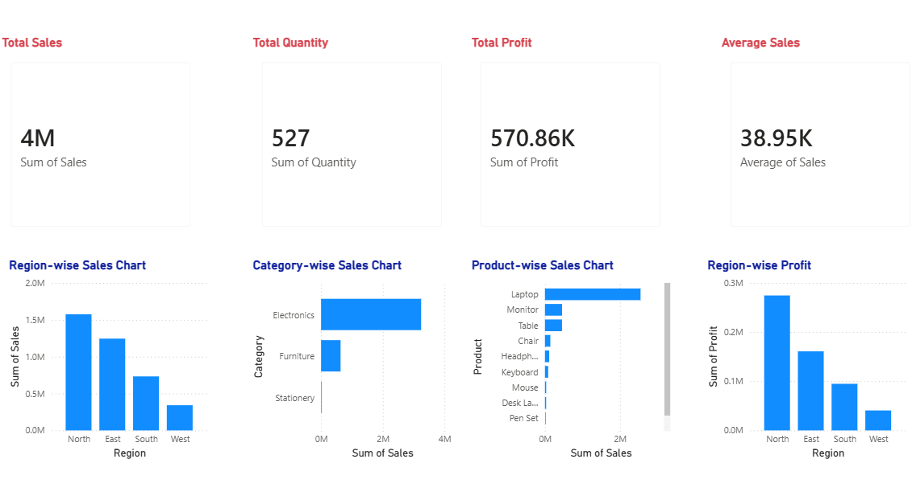

# Sales Data Analysis Dashboard

## Project Overview

This project focuses on analyzing sales data and presenting meaningful business insights through an interactive Power BI dashboard. The goal is to understand sales performance and help businesses make data-driven decisions.

## Objectives

* Analyze overall sales performance.
* Compare sales across different regions.
* Understand category-wise sales distribution.
* Present key information through an interactive dashboard.
* Support better business decision-making using data.

## Tools & Technologies

* **Microsoft Excel** – Data handling and analysis
* **CSV** – Dataset storage
* **Microsoft Power BI** – Dashboard development and visualization

## Project Files

* `Sales_Data_Analysis_Dashboard.pbix` – Power BI dashboard file
* `Sales_Data_Analysis_Project.csv` – Sales dataset in CSV format
* `Sales_Data_Analysis_Project.xlsx` – Excel dataset

## Dashboard Preview

## Dashboard Features

* Overall sales performance analysis
* Region-wise sales comparison
* Category-wise sales analysis
* Interactive data visualizations

## Key Learnings

* Understanding and analyzing sales data
* Creating meaningful business visualizations
* Presenting data in a clear and structured format
* Using dashboards to support business decisions

## How to Use

1. Download or clone this repository.
2. Open the `.pbix` file using Microsoft Power BI Desktop.
3. If required, update the dataset source path.
4. Explore the dashboard and its visualizations.

## Author

**Kajal Vishwakarma**

B.Tech Computer Science Engineering Student | Aspiring Data Analyst
